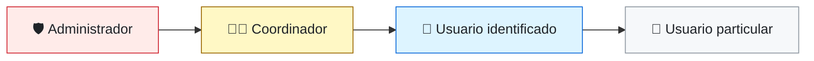

# Roles y permisos del sistema de módulos

Este documento describe el modelo de **roles y permisos** de la plataforma: quién puede ver, crear, aprobar y administrar módulos, grupos y visualizaciones.

## Contenido

- [Resumen](#resumen)
- [Jerarquía de roles](#jerarquía-de-roles)
- [Diagrama completo de permisos](#diagrama-completo-de-permisos)
- [Detalle por rol](#detalle-por-rol)
- [Niveles de visibilidad](#niveles-de-visibilidad)

## Resumen

| Rol | Requiere sesión | Alcance | Resumen |
|---|---|---|---|
| **Usuario particular** | No | Contenido público | Consulta módulos públicos y puede registrarse. |
| **Usuario identificado** | Sí | Sus módulos, sus grupos y lo que le aprueben | Ve más contenido, crea módulos, grupos y visualizaciones, y solicita accesos. |
| **Coordinador** | Sí | Los grupos que coordina | Gestiona la visibilidad, las solicitudes y la auditoría de su grupo. |
| **Administrador** | Sí | Todo el sistema | Gestiona grupos, roles, etiquetas, usuarios, accesos y auditoría global. |

## Jerarquía de roles

Cada rol **hereda todos los permisos** del rol anterior y agrega los propios.

> Las flechas indican el sentido de la herencia: el rol de destino incluye los permisos del rol de origen.

## Diagrama completo de permisos

![Diagrama de casos de uso: roles y permisos del sistema de módulos](https://www.plantuml.com/plantuml/png/XLQnRXmt4EttAmPA4HiusT0PRb8OlfnWnONXWmIfI2x5t79kHOXBhZXB2PBZZt7f8fMxjFTZ6PAh3RMdG18ME0w7RsRUFCxkU-xHzw4rLUyww1riND-x5fJsLFVQsOgljEtGOmjyYShTQjl05WrJiODrx_nPVsS8y9ROjULcX_KLDfIt8ohQnfGErYbYwk3eRM7qQA-YSLuQ0rEDJF2b0lXLO1llWbLBPvo7dpuSn_-uuxmYFrZVfh_gQrNz31-qGL2KqoN-1ThTDuQEVAlPCRpGzzT1arVu4WxVGKlMbRk2IVKblgpISJXOg5PRpRqNLlm18CFY-65lwIG7RSUTvUU7dNCEwBLRMwt8zdghQt5AFkSV9puWHVUw3WRzshvWRO69zUw7VPdzLrMrE8P3hvlB_l2lTp78ydEn5i3pZ-LQ3epymy6Pv4vj8gJT_L31E3uGPYk0qQaiiewHeJ5kWoR5Nqdms0WOst9mGXmrWnxg8DKXIzvIaxv1FmCEt94L5cThYwoRw8RG-D0v7YewUWot6BoyCr0mkhPtGBs-3YGHqi7JwS7EIvh-TMhOVKm7sqqaNL42mn8k8yoVH01sHjUw3ueuAwSc5XmSAOlMEg19oidLP2qi9paTqrQOz72ZMM-qqGeLt47hLDA05FKSuicRnu1BPpcOFh8ObEwTt_sDKBksCyAB42_dTz_j3Ax3xljC47VVh7APw4LY-kkarwbxiScAW4CHUIMo-l9iDMixFRSyUQulsZO-4NetK0kFc3MFmER_Lx-d9ahKoOcrpQrcs4_cpNxDurNRkuqhkJgJcfUUS6W89tv99S9TgQPCS57uv6ACrGaLdKv0TSIL3ZcxrKtmyhkaDGD-EdeYbzU5UkH4GAFliPOubA_5nU-JKsTPpUZtsLvRDzmIo9Sa8PnD02wegA3aZ6T3-taW2AIZgTlA3SdCdw1_aTFeTlzi9BC7vbSbyzEme_C0EydmD6i1FLEMUbPwclzBL9Y7F-JciTlu99FQcT1QJFDKkLjx-2wEjpXEnwLCLv74k8p3TLKiLob0Xc4W2rjjS1Qv7DygW32yGwfL3FJ7fLP2uPzvGAS8ykpR9PGyK_iO4pchFSH-Tjf4nk66ugi3JIij8jcr-Ng0z0h7Qi-F_WDDXSH1Uhfld5UdywanpZTvfcQvP2TlfiOuRghboTGvNMbvzim2KkrxonNuD3KcYSipDOjkp_PzvrLriMSLWLJMzVJmvUEs89q7M9WQRKs3Hdgd7901pY_DL-Bm6_ce8LD-92XAQqNfoy8xG_og8giWHgZUow_Gcdy1)

> Los roles están ordenados de izquierda a derecha, del que tiene más permisos al que tiene menos. Cada rol hereda los permisos del que está a su derecha.

## Detalle por rol

### 👤 Usuario particular (sin inicio de sesión)

| Categoría | Permisos |
|---|---|
| Visualización | Ver los módulos configurados como públicos. |
| Acceso | Registrarse como usuario identificado. |

### 🔐 Usuario identificado (con inicio de sesión)

| Categoría | Permisos |
|---|---|
| Visualización | Ver los módulos públicos. |
| | Ver los módulos configurados como solo usuarios identificados. |
| | Ver los módulos de los grupos a los que pertenece. |
| | Ver módulos de otros usuarios o grupos una vez aprobada su solicitud de acceso. |
| Solicitudes | Solicitar acceso para visualizar los módulos de ciertos usuarios o grupos. |
| | Solicitar el cambio de rol a Coordinador. |
| Gestión de módulos | Agregar módulos propios y definir su visibilidad (público, solo identificados, grupo o privado). |
| | Modificar la configuración de sus módulos propios. |
| Visualizaciones | Crear y modificar visualizaciones (paneles, gráficas) sobre los módulos a los que tiene acceso. |

### 🧑‍🏫 Coordinador

Identificado que coordina uno o más grupos. **Hereda todos los permisos del usuario identificado.**

| Categoría | Permisos |
|---|---|
| Grupos | Crear uno o varios grupos de trabajo. |
| Gestión de su grupo | Definir la visibilidad del grupo (público, solo identificados o privado). |
| Solicitudes de su grupo | Aprobar o rechazar solicitudes de acceso a los módulos de su grupo. |
| | Aprobar o rechazar solicitudes de ingreso a su grupo. |
| Auditoría de su grupo | Consultar el registro de cambios de configuración de su grupo. |

### 🛡️ Administrador

**Hereda todos los permisos de los demás roles, con alcance sobre todo el sistema.**

| Categoría | Permisos |
|---|---|
| Grupos | Crear grupos de trabajo (por ejemplo, "Semillero BioRed", "Semillero aliado", "Independientes"). |
| | Definir la visibilidad de cualquier grupo. |
| Roles y etiquetas | Aprobar o rechazar las solicitudes de cambio de rol a Coordinador. |
| | Asignar el rol de Coordinador directamente. |
| | Asignar etiquetas a las personas (por ejemplo, "Estudiante de semillero", "Profesor aliado"). |
| Accesos | Aprobar o rechazar solicitudes de acceso a módulos de cualquier grupo. |
| Módulos | Modificar la configuración de módulos ajenos. |
| Usuarios | Gestionar cuentas: activar, suspender y asignar usuarios a grupos. |
| Auditoría | Consultar el registro de auditoría completo (quién, qué, cuándo). |

## Niveles de visibilidad

**Módulos**

| Visibilidad | Quién puede verlo |
|---|---|
| Público | Cualquier persona, con o sin sesión. |
| Solo identificados | Usuarios con sesión iniciada. |
| Grupo | Miembros del grupo al que pertenece el módulo. |
| Privado | Solo su propietario (y el Administrador). Otros usuarios pueden acceder si su solicitud es aprobada. |

**Grupos**

| Visibilidad | Quién puede verlo |
|---|---|
| Público | Cualquier persona. |
| Solo identificados | Usuarios con sesión iniciada. |
| Privado | Solo sus miembros. |
