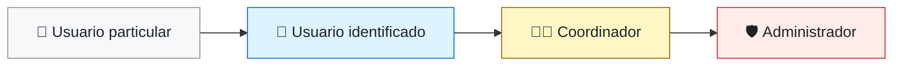

# Roles y permisos del sistema de módulos

Este documento describe el modelo de **roles y permisos** de la plataforma: quién puede ver, crear, aprobar y administrar módulos, grupos y visualizaciones.

## Contenido

- [Resumen](#resumen)
- [Jerarquía de roles](#jerarquía-de-roles)
- [Diagrama completo de permisos](#diagrama-completo-de-permisos)
- [Detalle por rol](#detalle-por-rol)
- [Niveles de visibilidad](#niveles-de-visibilidad)

## Resumen

| Rol | Requiere sesión | Alcance | Resumen |
|---|---|---|---|
| **Usuario particular** | No | Contenido público | Consulta módulos públicos y puede registrarse. |
| **Usuario identificado** | Sí | Sus módulos, sus grupos y lo que le aprueben | Ve más contenido, crea módulos, grupos y visualizaciones, y solicita accesos. |
| **Coordinador** | Sí | Los grupos que coordina | Gestiona la visibilidad, las solicitudes y la auditoría de su grupo. |
| **Administrador** | Sí | Todo el sistema | Gestiona grupos, roles, etiquetas, usuarios, accesos y auditoría global. |

## Jerarquía de roles

Cada rol **hereda todos los permisos** del rol anterior y agrega los propios.

> Las flechas indican el sentido de la herencia: el rol de destino incluye los permisos del rol de origen.

## Diagrama completo de permisos

```mermaid
flowchart BT
    classDef rol fill:#1f6feb,stroke:#0b3d91,color:#fff,font-weight:bold
    classDef cat fill:#f6f8fa,stroke:#8c959f,color:#1f2328,text-align:left

    subgraph UP["👤 Usuario particular (sin inicio de sesión)"]
        direction TB
        UP_R["Usuario particular"]:::rol
        UP_V["<b>Visualización</b><br/>• Ver módulos públicos"]:::cat
        UP_A["<b>Acceso</b><br/>• Registrarse como usuario identificado"]:::cat
        UP_R --- UP_V
        UP_R --- UP_A
    end

    subgraph UI["🔐 Usuario identificado (con inicio de sesión)"]
        direction TB
        UI_R["Usuario identificado"]:::rol
        UI_V["<b>Visualización</b><br/>• Ver módulos públicos<br/>• Ver módulos solo para identificados<br/>• Ver módulos de sus grupos<br/>• Ver módulos de otros (solicitud aprobada)"]:::cat
        UI_S["<b>Solicitudes</b><br/>• Solicitar acceso a módulos de usuarios o grupos<br/>• Solicitar cambio de rol a Coordinador"]:::cat
        UI_G["<b>Grupos</b><br/>• Crear grupos de trabajo<br/>• Queda como Coordinador de cada grupo creado"]:::cat
        UI_M["<b>Gestión de módulos</b><br/>• Agregar módulos propios y definir visibilidad<br/>&nbsp;&nbsp;(público, identificados, grupo, privado)<br/>• Modificar configuración de sus módulos"]:::cat
        UI_Z["<b>Visualizaciones</b><br/>• Crear y modificar paneles y gráficas<br/>&nbsp;&nbsp;sobre los módulos a los que tiene acceso"]:::cat
        UI_R --- UI_V
        UI_R --- UI_S
        UI_R --- UI_G
        UI_R --- UI_M
        UI_R --- UI_Z
    end

    subgraph CO["🧑‍🏫 Coordinador (coordina uno o más grupos)"]
        direction TB
        CO_R["Coordinador"]:::rol
        CO_G["<b>Gestión de su grupo</b><br/>• Definir visibilidad del grupo<br/>&nbsp;&nbsp;(público, identificados, privado)"]:::cat
        CO_S["<b>Solicitudes de su grupo</b><br/>• Aprobar/rechazar acceso a módulos del grupo<br/>• Aprobar/rechazar ingreso al grupo"]:::cat
        CO_A["<b>Auditoría de su grupo</b><br/>• Consultar registro de cambios de configuración"]:::cat
        CO_R --- CO_G
        CO_R --- CO_S
        CO_R --- CO_A
    end

    subgraph AD["🛡️ Administrador (alcance: todo el sistema)"]
        direction TB
        AD_R["Administrador"]:::rol
        AD_G["<b>Grupos</b><br/>• Crear grupos de trabajo<br/>&nbsp;&nbsp;(Semillero BioRed, Semillero aliado, Independientes)<br/>• Definir visibilidad de cualquier grupo"]:::cat
        AD_RE["<b>Roles y etiquetas</b><br/>• Aprobar/rechazar cambio de rol a Coordinador<br/>• Asignar rol de Coordinador directamente<br/>• Asignar etiquetas a personas<br/>&nbsp;&nbsp;(Estudiante de semillero, Profesor aliado)"]:::cat
        AD_AC["<b>Accesos</b><br/>• Aprobar/rechazar acceso a módulos de cualquier grupo"]:::cat
        AD_M["<b>Módulos</b><br/>• Modificar configuración de módulos ajenos"]:::cat
        AD_U["<b>Usuarios</b><br/>• Activar y suspender cuentas<br/>• Asignar usuarios a grupos"]:::cat
        AD_AU["<b>Auditoría</b><br/>• Consultar registro completo (quién, qué, cuándo)"]:::cat
        AD_R --- AD_G
        AD_R --- AD_RE
        AD_R --- AD_AC
        AD_R --- AD_M
        AD_R --- AD_U
        AD_R --- AD_AU
    end

    UI_R -. "hereda de" .-> UP_R
    CO_R -. "hereda de" .-> UI_R
    AD_R -. "hereda de" .-> CO_R
```

<b>Ver diagrama completo</b> (clic para desplegar)

## Detalle por rol

### 👤 Usuario particular (sin inicio de sesión)

| Categoría | Permisos |
|---|---|
| Visualización | Ver los módulos configurados como públicos. |
| Acceso | Registrarse como usuario identificado. |

### 🔐 Usuario identificado (con inicio de sesión)

| Categoría | Permisos |
|---|---|
| Visualización | Ver los módulos públicos. |
| | Ver los módulos configurados como solo usuarios identificados. |
| | Ver los módulos de los grupos a los que pertenece. |
| | Ver módulos de otros usuarios o grupos una vez aprobada su solicitud de acceso. |
| Solicitudes | Solicitar acceso para visualizar los módulos de ciertos usuarios o grupos. |
| | Solicitar el cambio de rol a Coordinador. |
| Grupos | Crear uno o varios grupos de trabajo y quedar como Coordinador de cada grupo que crea. |
| Gestión de módulos | Agregar módulos propios y definir su visibilidad (público, solo identificados, grupo o privado). |
| | Modificar la configuración de sus módulos propios. |
| Visualizaciones | Crear y modificar visualizaciones (paneles, gráficas) sobre los módulos a los que tiene acceso. |

### 🧑‍🏫 Coordinador

Identificado que coordina uno o más grupos. **Hereda todos los permisos del usuario identificado.**

| Categoría | Permisos |
|---|---|
| Gestión de su grupo | Definir la visibilidad del grupo (público, solo identificados o privado). |
| Solicitudes de su grupo | Aprobar o rechazar solicitudes de acceso a los módulos de su grupo. |
| | Aprobar o rechazar solicitudes de ingreso a su grupo. |
| Auditoría de su grupo | Consultar el registro de cambios de configuración de su grupo. |

### 🛡️ Administrador

**Hereda todos los permisos de los demás roles, con alcance sobre todo el sistema.**

| Categoría | Permisos |
|---|---|
| Grupos | Crear grupos de trabajo (por ejemplo, "Semillero BioRed", "Semillero aliado", "Independientes"). |
| | Definir la visibilidad de cualquier grupo. |
| Roles y etiquetas | Aprobar o rechazar las solicitudes de cambio de rol a Coordinador. |
| | Asignar el rol de Coordinador directamente. |
| | Asignar etiquetas a las personas (por ejemplo, "Estudiante de semillero", "Profesor aliado"). |
| Accesos | Aprobar o rechazar solicitudes de acceso a módulos de cualquier grupo. |
| Módulos | Modificar la configuración de módulos ajenos. |
| Usuarios | Gestionar cuentas: activar, suspender y asignar usuarios a grupos. |
| Auditoría | Consultar el registro de auditoría completo (quién, qué, cuándo). |

## Niveles de visibilidad

**Módulos**

| Visibilidad | Quién puede verlo |
|---|---|
| Público | Cualquier persona, con o sin sesión. |
| Solo identificados | Usuarios con sesión iniciada. |
| Grupo | Miembros del grupo al que pertenece el módulo. |
| Privado | Solo su propietario (y el Administrador). Otros usuarios pueden acceder si su solicitud es aprobada. |

**Grupos**

| Visibilidad | Quién puede verlo |
|---|---|
| Público | Cualquier persona. |
| Solo identificados | Usuarios con sesión iniciada. |
| Privado | Solo sus miembros. |

> **Nota:** las definiciones de "quién puede verlo" son una interpretación de la tabla de permisos. Ajústalas si las reglas reales del sistema difieren.
